# What is TracerNet learning?

Does TracerNet follow the geometric minimum of the surface, or the hand-drawn line where the two differ? Method after Svatko et al., *Deep Learning for BioImaging: What Are We Really Learning?* (arXiv 2603.13377): simple baselines, untrained-network baselines, layer-wise probing and PCA dimensionality. Seeds: [0, 1, 2]; test models: 3; commit `cc51ad3f13`; device mps. Generated by `python -m archcut3d.ml.report`; raw numbers are in the CSVs next to this file.

## Dataset

| label file | traces | points | traced mm | mm/px | median point spacing (mm) | used |
|---|---|---|---|---|---|---|
| A0047_Open_nose.label.npz | 2 | 23 | 24.85 | 0.02734 | 1.132 | yes |
| HLT_Figurine_Open.label.npz | 1 | 13 | 39.88 | 0.04331 | 3.328 | yes |
| Hatzor Seal Open.label.npz | 323 | 22057 | 741.82 | 0.05567 | 0.03 | no: machine-generated (point spacing < 2.0 px) |
| NEGII_Frida open full front.label.npz | 4 | 49 | 106.58 | 0.12541 | 2.392 | yes |

4 label files, 4 distinct scanned models; 3 used. Pixel size of the used models: 0.0273–0.1254 mm/px (4.6x). Across all 7 scans of the collection the range is 0.011–0.359 mm/px (about 33x). Models: A0047_Open_nose.wrl, HLT_Figurine_Open.wrl, NEGII_Frida open full front.wrl.

Training samples with the default sampling (0.3 mm steps, 4 jittered copies per anchor, 2 past-the-end anchors per line end):

| model | samples | clean | jittered | past the end | stop = 1 | stop base rate |
|---|---|---|---|---|---|---|
| A0047_Open_nose.wrl | 438 | 86 | 344 | 8 | 18 | 4.1% |
| HLT_Figurine_Open.wrl | 674 | 134 | 536 | 4 | 9 | 1.3% |
| NEGII_Frida open full front.wrl | 1816 | 360 | 1440 | 16 | 36 | 2.0% |
| all | 2928 | 580 | 2320 | 28 | 63 | 2.2% |

### Where the hand line departs from the geometric minimum

A hand-trace point is a *departure* if the local-relief minimum on the perpendicular through it (±0.5 mm, tilt corrected) is more than 0.1 mm away, or the dip there is shallower than 5.9 µm (the 10th percentile of dip depths with an interior minimum).

| model | points | mm/px | departure | minimum at band edge | median |offset| mm | median dip depth µm | departure if offset > 0.2 mm | if > 0.3 mm |
|---|---|---|---|---|---|---|---|---|
| A0047_Open_nose.wrl | 84 | 0.027 | 80% | 27% | 0.31 | 13.5 | 70% | 55% |
| HLT_Figurine_Open.wrl | 133 | 0.043 | 23% | 0% | 0.06 | 183.5 | 1% | 0% |
| NEGII_Frida open full front.wrl | 356 | 0.125 | 95% | 74% | 0.50 | 0.0 | 91% | 88% |

The offset threshold (0.1 mm) is below the pixel size of the coarsest model, so for that model it is below what a hand click can resolve; the last two columns show how the fractions change with a looser threshold.

## Departure vs normal points (key result)

All columns are measured on hand-trace points of the held-out model, split into *departure* points (hand line far from the local geometric minimum) and *normal* points.

* **step dist**: one-step distance between a tracer's next point and the hand's next point, from the hand pose.
* **lateral corr / slope with geometric step**: how a tracer's sideways step co-varies with the geometric tracer's sideways step over the points (slope 0: ignores the local minimum, 1: reproduces it; n/a when the tracer never steers sideways).
* **displaced**: the same one-step test from deliberately displaced poses (4 per point, identical for every tracer, up to 0.25 mm and 15° off the hand line), where going straight on is no longer the hand's direction. *pred→hand line* is the distance of the predicted next point from the hand line (the poses start about 0.10 mm away; lower means steering back); *closer to hand* is the fraction of poses where the prediction is nearer the hand's next point than the geometric tracer's next point.
* **hand→path**: closed loop, mean distance from hand points to the path the tracer draws from the start of the line (dominated by drift once a path leaves the line).

Baselines that cannot stop (straight, geometric) are given exactly the hand-trace length as step budget; this is an oracle and flatters them. Learned tracers decide their own end (budget 1.5x the hand length).

### Departure and normal points

| variant | departure: step dist mm | departure: lateral corr with geometric step | departure: lateral slope on geometric step | departure: displaced: pred→hand line mm | departure: displaced: closer to hand | departure: hand→path mm | normal: step dist mm | normal: lateral corr with geometric step | normal: lateral slope on geometric step | normal: displaced: pred→hand line mm | normal: displaced: closer to hand | normal: hand→path mm |
|---|---|---|---|---|---|---|---|---|---|---|---|---|
| TracerNet (hand labels) | 0.166 ± 0.106 | 0.031 ± 0.137 | -0.011 ± 0.007 | 0.165 ± 0.042 | 0.690 ± 0.221 | 5.317 ± 4.085 | 0.183 ± 0.118 | 0.097 ± 0.222 | 0.008 ± 0.070 | 0.169 ± 0.045 | 0.433 ± 0.060 | 7.320 ± 5.691 |
| random encoder (E1) | 0.155 ± 0.117 | 0.076 ± 0.197 | 0.002 ± 0.010 | 0.122 ± 0.020 | 0.693 ± 0.267 | 6.216 ± 3.085 | 0.216 ± 0.218 | 0.095 ± 0.226 | 0.018 ± 0.023 | 0.116 ± 0.014 | 0.453 ± 0.119 | 7.945 ± 4.625 |
| TracerNet trained on crest-line labels (E5) | 0.082 ± 0.012 | -0.080 ± 0.119 | -0.006 ± 0.010 | 0.114 ± 0.001 | 0.682 ± 0.300 | 5.251 ± 2.475 | 0.093 ± 0.021 | 0.028 ± 0.201 | 0.038 ± 0.086 | 0.104 ± 0.006 | 0.404 ± 0.148 | 6.888 ± 4.376 |
| height only (E2) | 0.095 ± 0.047 | -0.091 ± 0.237 | -0.010 ± 0.019 | 0.134 ± 0.025 | 0.661 ± 0.239 | 7.573 ± 4.568 | 0.096 ± 0.043 | -0.006 ± 0.085 | -0.010 ± 0.022 | 0.126 ± 0.017 | 0.358 ± 0.110 | 9.679 ± 6.289 |
| local_relief only (E2) | 0.375 ± 0.440 | 0.086 ± 0.208 | 0.040 ± 0.073 | 0.356 ± 0.344 | 0.532 ± 0.212 | 6.051 ± 3.334 | 0.517 ± 0.672 | 0.009 ± 0.198 | -0.262 ± 0.601 | 0.457 ± 0.523 | 0.385 ± 0.113 | 8.481 ± 5.455 |
| curvature only (E2) | 0.076 ± 0.052 | -0.083 ± 0.040 | -0.024 ± 0.015 | 0.129 ± 0.032 | 0.675 ± 0.303 | 3.616 ± 5.525 | 0.088 ± 0.061 | -0.003 ± 0.293 | -0.043 ± 0.082 | 0.134 ± 0.036 | 0.386 ± 0.173 | 3.747 ± 5.308 |
| flatten instead of pooling (E4) | 0.171 ± 0.115 | 0.051 ± 0.344 | 0.015 ± 0.057 | 0.162 ± 0.090 | 0.708 ± 0.291 | 6.799 ± 4.386 | 0.166 ± 0.094 | -0.000 ± 0.397 | 0.070 ± 0.184 | 0.149 ± 0.070 | 0.470 ± 0.155 | 7.728 ± 5.665 |
| CoordConv (E4) | 0.113 ± 0.057 | 0.190 ± 0.440 | 0.047 ± 0.099 | 0.132 ± 0.018 | 0.675 ± 0.267 | 4.936 ± 3.696 | 0.138 ± 0.073 | 0.123 ± 0.221 | 0.029 ± 0.117 | 0.131 ± 0.014 | 0.424 ± 0.108 | 6.448 ± 4.936 |
| geometric tracer (W = 0.5 mm) | 0.301 ± 0.177 | 1.000 ± 0.000 | 1.000 ± 0.000 | 0.316 ± 0.165 | 0.000 ± 0.000 | 3.672 ± 3.367 | 0.144 ± 0.074 | 1.000 ± 0.000 | 1.000 ± 0.000 | 0.141 ± 0.051 | 0.000 ± 0.000 | 5.393 ± 5.616 |
| geometric tracer (W = 0.25 mm) | 0.155 ± 0.065 | 0.431 ± 0.166 | 0.253 ± 0.175 | 0.188 ± 0.045 | 0.359 ± 0.206 | 4.387 ± 5.215 | 0.072 ± 0.016 | 0.456 ± 0.428 | 0.309 ± 0.355 | 0.099 ± 0.010 | 0.197 ± 0.123 | 4.013 ± 4.752 |
| straight ahead | 0.009 ± 0.010 | n/a | n/a | 0.113 ± 0.005 | 0.667 ± 0.328 | 2.577 ± 2.027 | 0.009 ± 0.012 | n/a | n/a | 0.104 ± 0.013 | 0.299 ± 0.137 | 3.639 ± 3.635 |

**One-step distance to the hand's next point (mm), per test model (departure points)**

| variant | A0047_Open_nose | HLT_Figurine_Open | NEGII_Frida open full front |
|---|---|---|---|
| TracerNet (hand labels) | 0.044 | 0.238 | 0.217 |
| geometric tracer (W = 0.5 mm) | 0.343 | 0.107 | 0.454 |
| straight ahead | 0.019 | 0.000 | 0.007 |
| random encoder (E1) | 0.066 | 0.111 | 0.287 |
| TracerNet trained on crest-line labels (E5) | 0.069 | 0.093 | 0.086 |

**Displaced poses: fraction closer to the hand than to the geometric step, per test model (departure points)**

| variant | A0047_Open_nose | HLT_Figurine_Open | NEGII_Frida open full front |
|---|---|---|---|
| TracerNet (hand labels) | 0.780 | 0.438 | 0.852 |
| geometric tracer (W = 0.5 mm) | 0.000 | 0.000 | 0.000 |
| straight ahead | 0.776 | 0.298 | 0.926 |
| random encoder (E1) | 0.792 | 0.390 | 0.896 |
| TracerNet trained on crest-line labels (E5) | 0.766 | 0.349 | 0.932 |

**Correlation of sideways step with the geometric tracer's, per test model (departure points)**

| variant | A0047_Open_nose | HLT_Figurine_Open | NEGII_Frida open full front |
|---|---|---|---|
| TracerNet (hand labels) | -0.065 | 0.187 | -0.029 |
| geometric tracer (W = 0.25 mm) | 0.355 | 0.621 | 0.316 |
| random encoder (E1) | 0.050 | 0.285 | -0.107 |
| TracerNet trained on crest-line labels (E5) | -0.033 | -0.215 | 0.009 |

**Closed-loop distance from hand points to the path (mm), per test model (departure points)**

| variant | A0047_Open_nose | HLT_Figurine_Open | NEGII_Frida open full front |
|---|---|---|---|
| TracerNet (hand labels) | 2.251 | 3.745 | 9.954 |
| geometric tracer (W = 0.5 mm) | 4.044 | 0.135 | 6.838 |
| straight ahead | 2.443 | 0.620 | 4.667 |

## E0: TracerNet vs baselines (all points)

### Closed-loop path metrics

| variant | all: chamfer mm | all: pred→hand mm | all: hand→pred mm | all: coverage 0.1 mm | all: length ratio | all: endpoint err mm |
|---|---|---|---|---|---|---|
| TracerNet (hand labels) | 4.088 ± 2.455 | 2.033 ± 1.246 | 6.142 ± 3.998 | 0.049 ± 0.039 | 1.115 ± 0.398 | 17.826 ± 8.556 |
| geometric tracer (W = 0.5 mm) | 3.096 ± 2.853 | 2.338 ± 2.147 | 3.855 ± 3.560 | 0.222 ± 0.344 | 1.012 ± 0.160 | 11.770 ± 10.453 |
| geometric tracer (W = 0.25 mm) | 3.477 ± 4.015 | 2.554 ± 2.775 | 4.400 ± 5.261 | 0.195 ± 0.271 | 0.933 ± 0.124 | 14.339 ± 15.437 |
| straight ahead | 2.486 ± 1.962 | 2.212 ± 1.935 | 2.760 ± 2.029 | 0.198 ± 0.027 | 0.918 ± 0.144 | 11.701 ± 9.762 |
### TracerNet one-step metrics on the test model

Angular error is measured on the dataset's anchors; a straight-ahead step scores about 1–3° on clean anchors, so it is the reference, not a 90° chance level.

| variant | all: angle err clean ° | all: angle err jittered ° | all: stop AUROC | all: stop precision | all: stop recall | all: stop base rate |
|---|---|---|---|---|---|---|
| TracerNet (hand labels) | 16.519 ± 8.104 | 29.113 ± 3.941 | 0.525 ± 0.037 | 0.000 | 0.000 ± 0.000 | 0.025 ± 0.015 |
### Step error by component (step units; clean and jittered anchors)

| variant | all: forward err clean | all: sideways err clean | all: forward err jittered | all: sideways err jittered |
|---|---|---|---|---|
| TracerNet (hand labels) | 0.318 ± 0.222 | 0.345 ± 0.195 | 0.490 ± 0.107 | 0.565 ± 0.151 |
| random encoder (E1) | 0.505 ± 0.404 | 0.100 ± 0.065 | 0.629 ± 0.345 | 0.395 ± 0.026 |
| height only (E2) | 0.208 ± 0.076 | 0.197 ± 0.145 | 0.395 ± 0.018 | 0.453 ± 0.079 |
| local_relief only (E2) | 0.552 ± 0.682 | 1.096 ± 1.311 | 0.713 ± 0.578 | 1.232 ± 1.203 |
| curvature only (E2) | 0.107 ± 0.024 | 0.213 ± 0.176 | 0.367 ± 0.011 | 0.437 ± 0.109 |
| flatten instead of pooling (E4) | 0.292 ± 0.175 | 0.374 ± 0.408 | 0.465 ± 0.081 | 0.517 ± 0.248 |
| CoordConv (E4) | 0.281 ± 0.180 | 0.206 ± 0.080 | 0.452 ± 0.072 | 0.438 ± 0.061 |
| TracerNet trained on crest-line labels (E5) | 0.233 ± 0.041 | 0.104 ± 0.043 | 0.412 ± 0.034 | 0.379 ± 0.013 |
## E1 and E2: random encoder and input channels

### Metrics, all points

| variant | all: angle err clean ° | all: angle err jittered ° | all: stop AUROC | all: chamfer mm | all: coverage 0.1 mm |
|---|---|---|---|---|---|
| TracerNet (hand labels) | 16.519 ± 8.104 | 29.113 ± 3.941 | 0.525 ± 0.037 | 4.088 ± 2.455 | 0.049 ± 0.039 |
| random encoder (E1) | 4.950 ± 0.844 | 23.350 ± 1.212 | 0.747 ± 0.127 | 5.082 ± 2.339 | 0.067 ± 0.057 |
| height only (E2) | 13.104 ± 9.341 | 28.036 ± 4.838 | 0.434 ± 0.294 | 6.034 ± 3.236 | 0.057 ± 0.066 |
| local_relief only (E2) | 27.822 ± 19.190 | 35.968 ± 10.546 | 0.720 ± 0.160 | 4.796 ± 1.915 | 0.035 ± 0.041 |
| curvature only (E2) | 11.301 ± 8.057 | 25.333 ± 4.054 | 0.541 ± 0.123 | 2.406 ± 2.603 | 0.106 ± 0.024 |
## E4: pooling variants

### Metrics, all points

| variant | all: angle err clean ° | all: angle err jittered ° | all: stop AUROC | all: chamfer mm | all: coverage 0.1 mm |
|---|---|---|---|---|---|
| TracerNet (hand labels) | 16.519 ± 8.104 | 29.113 ± 3.941 | 0.525 ± 0.037 | 4.088 ± 2.455 | 0.049 ± 0.039 |
| flatten instead of pooling (E4) | 20.384 ± 17.014 | 29.145 ± 9.689 | 0.679 ± 0.237 | 5.019 ± 3.181 | 0.065 ± 0.077 |
| CoordConv (E4) | 12.592 ± 5.219 | 26.721 ± 3.700 | 0.568 ± 0.073 | 3.679 ± 2.196 | 0.073 ± 0.086 |
## E5: trained on geometry-only (crest-line) labels

| scan | vertices | crest lines kept | total mm | note |
|---|---|---|---|---|
| A0047_Open_nose.wrl | – | 1 | 0.0 |  |
| HLT_Figurine_Open.wrl | – | 14 | 77.0 |  |
| Hatzor Seal Open.wrl | – | 67 | 285.6 |  |
| KHH J56a open.wrl | – | 4 | 17.8 |  |
| L10636_B116316_handle_open.wrl | – | – | – | L10636_B116316_handle_open.wrl: 1995 vertices, too coarse (< 5000) |
| Liron PatchC.wrl | – | 1 | 0.0 |  |
| NEGII_Frida open full front.wrl | – | 80 | 337.3 |  |

## E3: representation analysis

PCA of the pooled 128-d features on the test model's clean anchors (mean ± std over folds and seeds):

| encoder | components for 80% | 90% | 95% | participation ratio |
|---|---|---|---|---|
| trained | 1.4 ± 0.7 | 2.2 ± 1.0 | 3.2 ± 1.6 | 1.7 ± 0.7 |
| random | 4.6 ± 4.2 | 9.3 ± 8.5 | 16.3 ± 13.1 | 3.0 ± 1.8 |

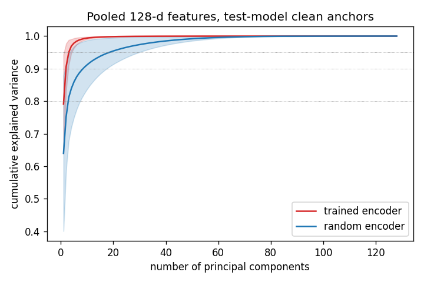

Linear probes on the global-average-pooled output of encoder blocks, trained on the other models' anchors and scored on the test model (mean over folds and seeds). `R2` is in the target's own units and goes strongly negative when a probe trained on other scans meets a different scale (dip depth differs by orders of magnitude between scans); `R2_z` standardises each target within each model first; Pearson r (block 6) ignores scale and offset altogether. `AUROC` is for the departure label (0.5 = chance).

| target | metric | encoder | block 1 | block 3 | block 6 | block 6 Pearson r |
|---|---|---|---|---|---|---|
| curvature at centre | R2 | trained | -10.81 | -3.77 | -4.25 | 0.04 |
| curvature at centre | R2 | random | -8.86 | -4.73 | -55.22 | -0.02 |
| curvature at centre | R2_z | trained | -0.63 | -0.40 | -0.55 | 0.07 |
| curvature at centre | R2_z | random | -0.31 | -0.27 | -2.48 | 0.02 |
| departure | AUROC | trained | 0.48 | 0.60 | 0.50 | – |
| departure | AUROC | random | 0.52 | 0.54 | 0.56 | – |
| geometric depth | R2 | trained | -137.79 | -7.55 | -148.08 | 0.04 |
| geometric depth | R2 | random | -162.03 | -56.26 | -64.14 | -0.01 |
| geometric depth | R2_z | trained | -3.05 | -6.18 | -1.64 | 0.01 |
| geometric depth | R2_z | random | -2.73 | -25.60 | -51.44 | -0.04 |
| lateral offset of hand line | R2 | trained | -1.77 | -3.20 | -0.87 | -0.11 |
| lateral offset of hand line | R2 | random | -1.28 | -3.58 | -3.97 | -0.10 |
| lateral offset of hand line | R2_z | trained | -1.66 | -3.00 | -0.88 | -0.11 |
| lateral offset of hand line | R2_z | random | -1.19 | -3.36 | -3.60 | -0.10 |
| relief at centre | R2 | trained | -9.27 | -8.35 | -20.16 | -0.26 |
| relief at centre | R2 | random | -8.82 | -12.55 | -10.83 | 0.40 |
| relief at centre | R2_z | trained | -0.78 | -2.18 | -0.73 | -0.01 |
| relief at centre | R2_z | random | -0.84 | -5.94 | -4.01 | -0.25 |

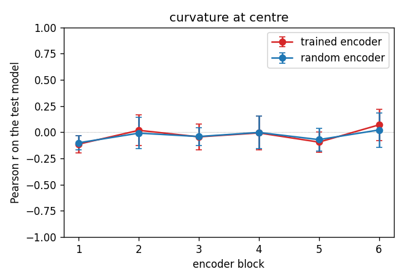
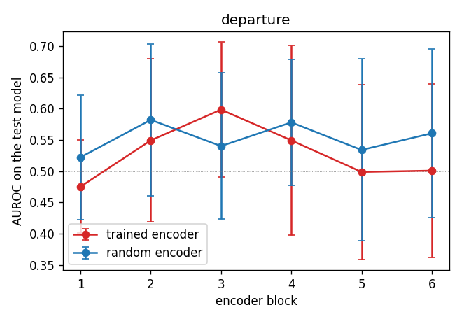
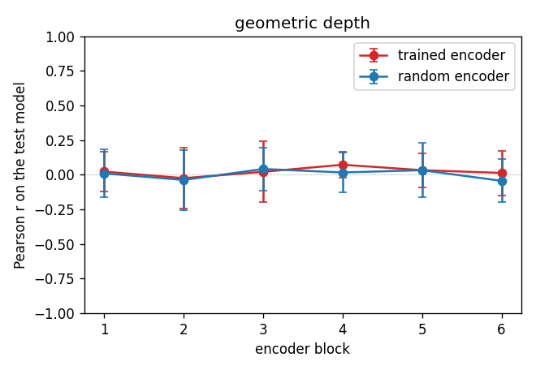
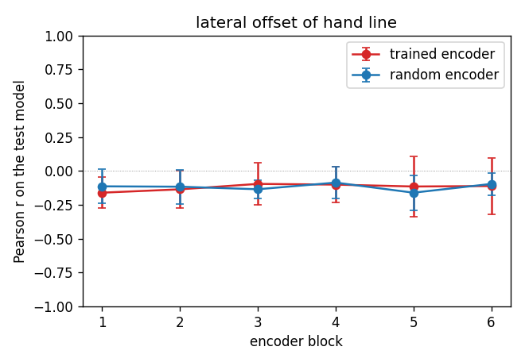
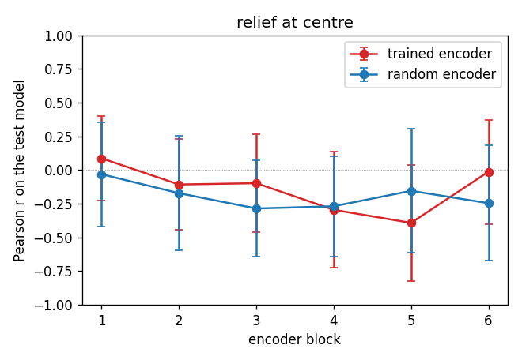

## Departure examples

Chosen automatically: largest geometric offsets, at most two per model.

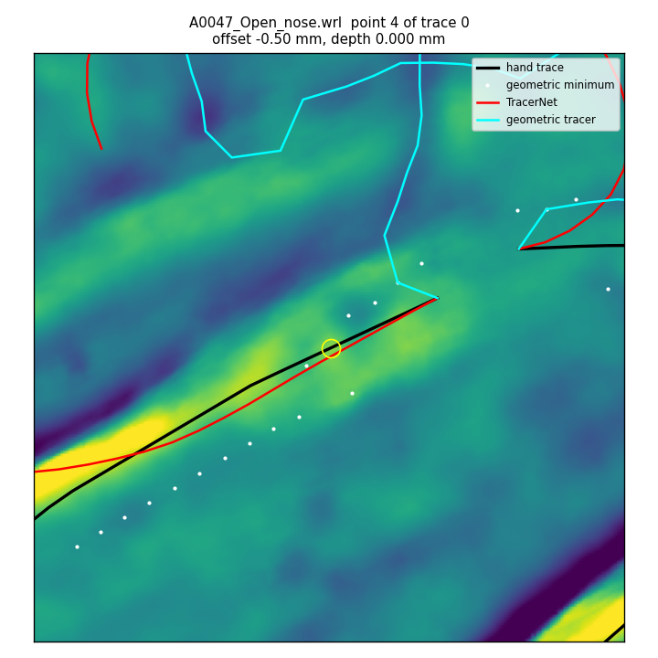
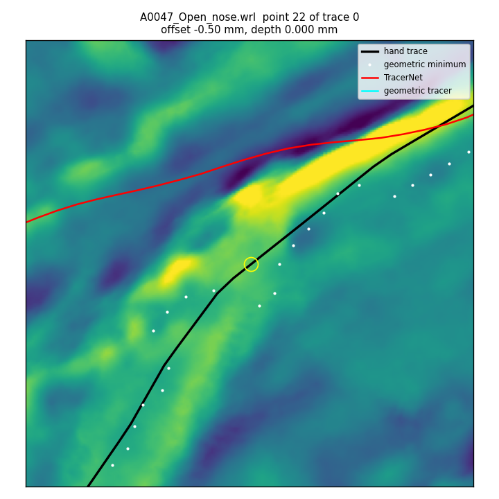
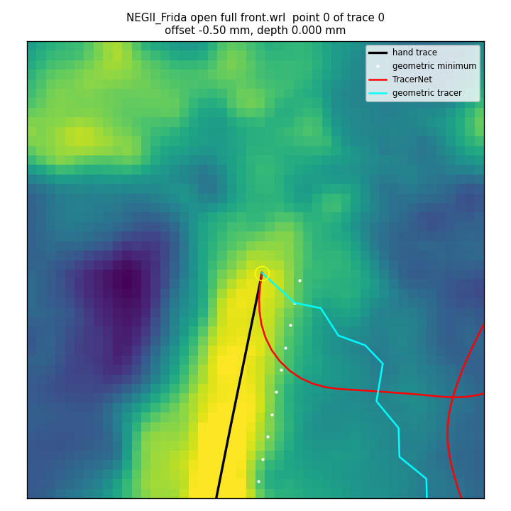
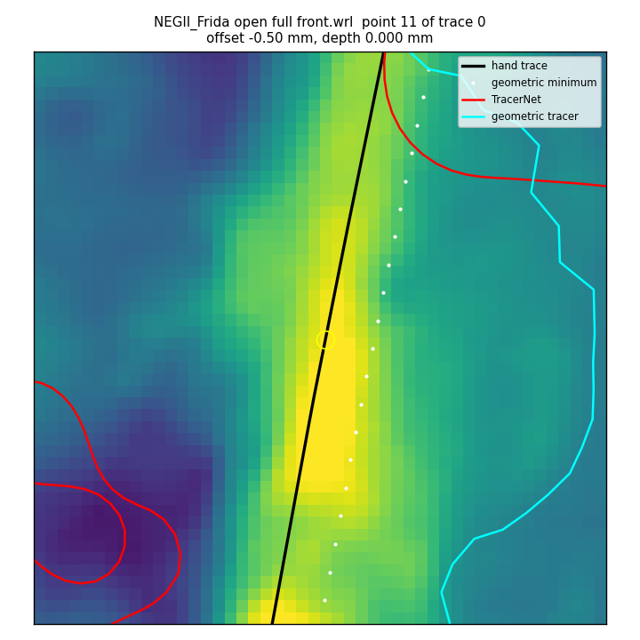
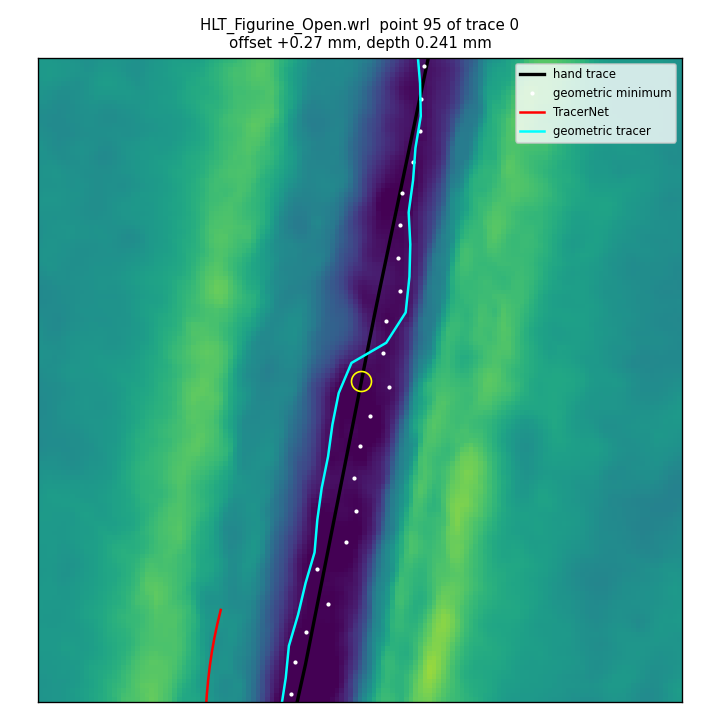
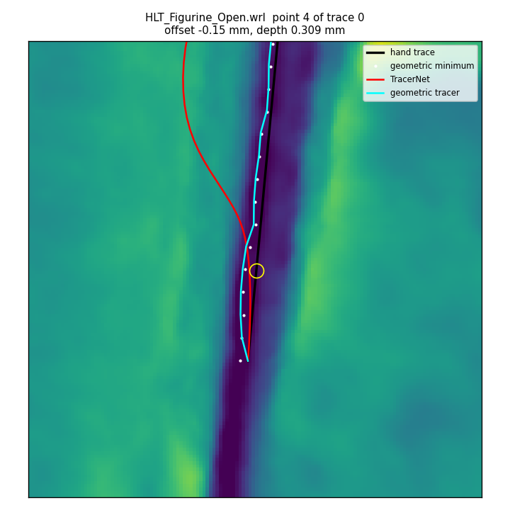

## Findings

1. **TracerNet is not a better tracer than "go straight on".** Over the three hand-traced models it is no more accurate than the straight-ahead baseline in one step (angular error 16.5 ± 8.1° on clean anchors, against 1.4 ± 1.5° for straight-ahead, which is the reference to use, not a 90° chance level) and worse in closed loop: chamfer distance 4.09 ± 2.46 mm against 2.49 ± 1.96 mm (straight) and 3.10 ± 2.85 mm (geometric tracer), and only 5% of hand points lie within 0.1 mm of its path against 20% and 22%. Its stop output is at chance (AUROC 0.53 ± 0.04, precision and recall 0).
2. **There is no sign that it follows the local geometric minimum.** The correlation between its sideways step and the geometric tracer's sideways step is 0.03 ± 0.14 on departure points and 0.10 ± 0.22 on normal points (slope −0.01 on departure points). On HLT, the one model whose hand line follows the surface minimum (23% departure points, median dip 184 µm), the geometric tracer reaches a chamfer of 0.10 mm with 62% of hand points within 0.1 mm; TracerNet reaches 3.4 mm and 3%.
3. **Nor is there a sign that it follows the hand line better than going straight.** From displaced poses that start 0.106 mm from the hand line, TracerNet's next point is 0.165 ± 0.042 mm from the line (straight-ahead: 0.113), so it does not steer back. On departure points it is "closer to the hand than to the geometric step" in 0.69 ± 0.22 of the poses, but straight-ahead scores 0.67 ± 0.33: it is nearer the hand only because it does not steer towards the geometric minimum.
4. **Departures are the rule on two of the three models.** The hand line is more than 0.1 mm from the local-relief minimum, or over a dip too shallow to count, at 80% of the points of A0047, 95% of NEGII and 23% of HLT. On NEGII the minimum of the perpendicular profile lies at the edge of the searched band for 74% of the points, and an independent check showed the hand line on a bump relative to its surroundings in 91% of them: the stroke crosses relief it does not follow. A geometric rule can therefore not reproduce the hand line on A0047 and NEGII (chamfer 3.4 and 5.8 mm); whether a learned model could is not answered by these runs.
5. **The random encoder does as well as the trained one on one-step steering, and the trained encoder's pooled features are nearly one-dimensional.** With only the heads trained, the random encoder has a lower one-step angular error (4.9 ± 0.8°) and a higher stop AUROC (0.75 ± 0.13) than the fully trained network. We checked that its encoder weights stay at the seeded initialisation, that both use identical splits, and what it outputs (seed 0: an almost constant sideways step of +0.05, i.e. it hardly steers, while the trained network has a sideways bias of −0.21 on clean anchors, which accounts for its larger angular error). The pooled features of the trained network have a participation ratio of 1.7 ± 0.7 and reach 90% of the variance in 2.2 components (random encoder: 3.0 ± 1.8 and 9.3). Linear probes on spatially averaged block outputs, trained on the other models and scored on the test model, read out the local relief at the patch centre only moderately and only from intermediate blocks (Pearson r 0.55 at block 3 of the trained network, 0.47 at block 5 of the random encoder); the trained network has lost it by its last block (r −0.26, against 0.40 for the random encoder). Curvature, dip depth, the line's lateral offset and the departure label are not recovered by either encoder at any block (|r| ≤ 0.16; departure AUROC 0.48–0.60).
6. **Input channels and pooling make no reliable difference at this sample size.** Curvature alone gives the lowest closed-loop chamfer of the learned variants (2.41 ± 2.60 mm, tied with straight-ahead); local_relief alone is the worst in one step (27.8 ± 19.2°). CoordConv lowers the sideways error on jittered anchors (0.44 ± 0.06 against 0.56 ± 0.15), flattening the feature map does not (0.52 ± 0.25); both differences are within the spread between folds.
7. **Geometry-only labels do not teach the geometric rule either.** The network trained on crest-line labels of the other scans (E5) steers less wildly (sideways error 0.10 ± 0.04 against 0.35 ± 0.19) but its sideways step is still uncorrelated with the geometric minimum (−0.08 ± 0.12). On the crest labels of a scan it did not see, it scores 10.0° against 8.3° for straight-ahead (E5b), so it did not learn the labels it was trained on. Crest-line ravines and the perpendicular-minimum rule are also different geometric definitions: the latter's step is 23.5° away from the crest lines.
8. **The most likely reason is data, not architecture.** Each fold trains on a single model and the validation loss is best after about 5 epochs (runs stop at about 25 with a patience of 20), so the network is stopped before it has fitted its one training model. These results therefore say that a TracerNet trained on this little data has learned neither the geometry nor the hand line, not that it could not.

**Limitations.**
- Only three hand-traced models (171 mm of line in total) are usable; the machine-generated Hatzor file is excluded. Every number is a mean over three seeds, then a mean ± std over only three test models, not a confidence interval.
- The hand traces of HLT and NEGII were clicked 3.3 and 2.4 mm apart and are interpolated linearly between clicks. The departure threshold (0.1 mm) is below NEGII's pixel size (0.125 mm), so for that model it is below what a click can resolve; with a threshold of 0.3 mm the departure fractions are 55%, 0% and 88% (A0047, HLT, NEGII).
- The label files do not record who traced them; if a single annotator drew all lines (as assumed), none of this separates annotator-specific habits from "semantic" behaviour.
- Straight-ahead and the geometric tracer cannot stop and are given exactly the hand-trace length as a step budget. This oracle flatters them in closed loop; learned tracers get 1.5 times the hand length and decide their own end.
- E1 freezes the encoder's weights, but BatchNorm running statistics still update and the encoder's dropout stays active while the heads train; the "random" features are evaluated with those updated statistics.
- "Geometric" means one particular rule (the tilt-corrected minimum of the local_relief profile within ±0.5 mm, with a 0.25 mm variant in E0) or one particular detector (crest-line ravines of at least 3 mm; scans with no such line, such as A0047 and Liron PatchC, give no E5 labels). The probes act on globally averaged features, which limits how well they can read out local quantities for any encoder.
- Runs on the Apple GPU (`mps`) are not guaranteed to be bit-reproducible; the E0 numbers were identical across two full runs here. On `cpu`, a seed reproduces a run exactly.

